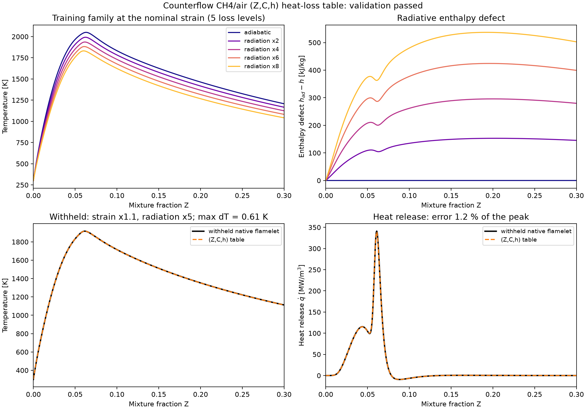
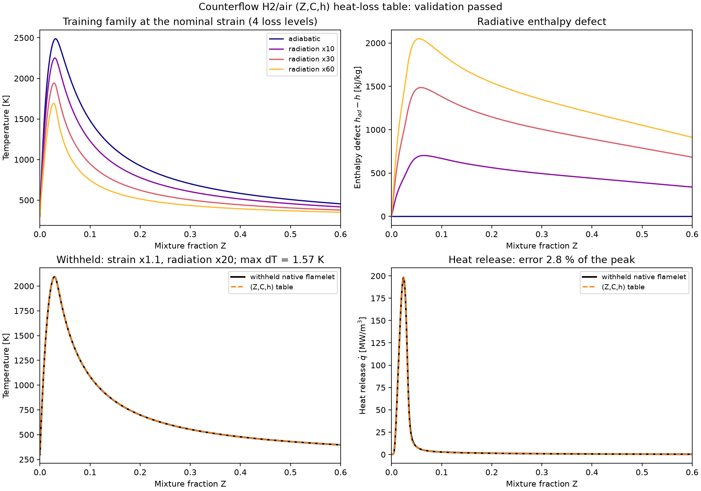

# Llamas no premezcladas en contraflujo

[Guía de lectura](README.md) ·
[Estado y prioridades HPC (2026-10-08)](reviews/repository-hpc-2026-10-08.md).

[Optimización del transporte multicomponente y Soret](hpc-multicomponent.md):
perfil de tiempo, mejoras seleccionadas, literatura y 554 pruebas aprobadas.

[Optimización de memoria, L1/L2 y buffers](hpc-memory-layout.md): disposición
de arrays, asignaciones evitadas y comparación exacta entre versiones.

[Continuación HPC: caras compartidas y derivadas por bloques](hpc-next-strategies.md):
implementación seleccionada, 463 pruebas y tiempos completos antes/después.

Para evaluar el rendimiento, empezar por
[las mediciones del Jacobiano por bloques](#rendimiento-de-alto-nivel-y-pérdidas-radiativas).
Las secciones anteriores de optimización conservan resultados históricos;
la revisión fechada enlaza mediciones del código local y hallazgos pendientes.

`solve_diffusion_flame` resuelve una llama de difusión axisimétrica entre dos
entradas independientes. Combustible y oxidante se mezclan dentro del dominio.
El mecanismo, las composiciones molares y las condiciones de entrada son
parámetros; las ecuaciones y la elección automática del progreso no contienen
coeficientes particulares de CH4 o H2.

```python
from kflame import solve_diffusion_flame, generate_diffusion_fgm, DiffusionFGM

settings = dict(mechanism='gri30.yaml', fuel='CH4', oxidizer='O2:1,N2:3.76',
                fuel_temperature=300., oxidizer_temperature=300.,
                pressure=101325., width=.02,
                fuel_mass_flux=.12, oxidizer_mass_flux=.24)
flame = solve_diffusion_flame(**settings, output='runs/ch4_diffusion')
family = generate_diffusion_fgm(**settings, flow_scales=(.75, 1., 1.25),
                               initial_solution=flame['output'],
                               output='runs/ch4_diffusion_fgm')
table = DiffusionFGM(family['output'])
# Consultar Z,C dentro de las celdas reales de la familia.
```

Ambos caudales son magnitudes positivas en kg/(m² s). El flujo axial sale de
la entrada de combustible con signo positivo y de la entrada de oxidante con
signo negativo. Para H2/aire se puede usar `h2o2.yaml`, `fuel='H2'` y los
caudales `.05` y `.15`. `transport='multicomponent'` y `soret=True` son opciones
independientes. No se asigna una velocidad laminar `Su` a esta configuración.

La API guarda `flame.npz`, todas las especies en `profiles.csv` y
`metadata.json`, incluyendo el mecanismo, su hash, el hash del código,
las condiciones físicas, las tolerancias y el historial de refinamiento.
`plots=True` añade perfiles PNG/PDF. Una solución rechazada conserva sus
diagnósticos y lanza `RuntimeError`. La continuación solo admite resultados
nativos aceptados con los mismos flujos de entrada químicos y transporte;
permite cambiar caudales y separación. Un directorio existente se rechaza.

```sh
flampy diffusion --fuel CH4 --output runs/ch4_diffusion
flampy diffusion --mechanism h2o2.yaml --fuel H2 --fuel-mass-flux .05 --oxidizer-mass-flux .15 --soret --output runs/h2_diffusion
flampy diffusion-fgm --initial-solution runs/ch4_diffusion --output runs/ch4_diffusion_fgm
flampy reference-diffusion --native runs/ch4_diffusion --output runs/ch4_cantera
python examples/example_diffusion.py --output runs/diffusion_example --reference
```

## Ecuaciones y convergencia

Las incógnitas son el caudal axial firmado `m=ρu`, la tasa de expansión radial
`V`, `T`, todas las fracciones másicas y el autovalor constante de presión
radial `Lambda`. Se resuelven continuidad `m' + 2ρV = 0`, momento radial,
especies y energía con química y transporte nativos. El gradiente convectivo
cambia de lado al cambiar el signo de `m`. Las dos entradas satisfacen
`m(Y-Y_feed)+J=0`; la normalización sustituye una ecuación de especie en cada
entrada, mientras el interior conserva todas las ecuaciones diferenciales.

Newton usa una Jacobiana compilada por bloques con borde para Lambda, una
factorización por ambos extremos, un modelo lineal persistente y amortiguación
basada en el error (véase [rendimiento](#rendimiento-de-alto-nivel-y-pérdidas-radiativas)).
Si la estimación inicial no converge, usa continuación temporal implícita y,
como último recurso, equilibrio HP nativo. Ninguna referencia
de Cantera inicializa una solución nativa. Se exige residuo escalado completo
menor que `1e-7`, conservación de la suma de especies y fracciones no menores
que `-1e-7`. La rama de llama debe alcanzar una temperatura al menos 100 K
superior a ambas entradas; configuraciones de entrada muy calientes pueden
necesitar otro criterio físico de identificación de combustión.

Los valores predeterminados son `ratio=3`, `slope=.01`, `curve=.02`,
`max_points=2400` y `max_time=600` s. La cota temporal corresponde a la fase de
resolución y puede sobrepasarse durante una operación individual. Una malla
fija (`refine=False`) acepta convergencia algebraica y declara
`grid_converged=False`; requiere un estudio espacial independiente.

La viscosidad de Wilke se calcula en un kernel Numba sin el tensor temporal
especies × especies × caras. La construcción del Jacobiano agrupa los valores
en arrays, evitando millones de objetos escalares Python en mecanismos grandes.
La continuación desde una llama aceptada evita repetir la inicialización fría.
Al cambiar la deformación, una malla inicial automática muy fina se reduce a
un subconjunto de hasta 201 nodos para la estimación inicial y después se refina
de nuevo con los mismos criterios. Una malla explícita del usuario se conserva.

## Entalpía y tabulación

`h` incluye entalpía sensible y de formación. También se guardan los flujos
conductivo, difusivo y axial total, y `2ρVh`, la exportación radial de entalpía.
El balance continuo es `(mh + q_conducción + Σh_k J_k)' + 2ρVh = 0`.
El informe calcula un defecto integrado entre la primera y la última cara.
La revisión posterior reconstruye el caudal de cara mediante la continuidad
trapezoidal, y usa `m_face*h_face` para su parte convectiva. El defecto relativo
se normaliza por `mref*cpref*Tref`, con escala guardada en el informe;
los porcentajes de diagnósticos históricos con otra escala no son comparables.
Es un diagnóstico de discretización: la convergencia algebraica y una buena
comparación de temperatura no garantizan por sí solas un balance integral
preciso. No se aplica la identidad planar de caudal constante a esta geometría.

La familia varía ambos caudales mediante `flow_scales`. Cada llama aporta su
trayectoria espacial en **Z local de Bilger**. Se construyen triángulos entre
trayectorias adyacentes en `(Z,C)`, con `C=Σα_kY_k` común a toda la familia y
su fuente `Σα_kω_k`. Los pesos se pueden proporcionar; la selección automática
busca una combinación lineal que separe las filas de deformación y admite
pesos con signo. Las trayectorias no se ordenan artificialmente por progreso.
Los pliegues se rechazan y las celdas degeneradas se excluyen con diagnóstico.
El dominio de mezcla se restringe a `0 ≤ Z ≤ 1`. Los excesos de Z causados
por difusión diferencial quedan fuera de la tabla y se registran como puntos
excluidos; sus composiciones no se recortan ni se proyectan sobre Z=0 o Z=1.
Las consultas fuera de las celdas disponibles lanzan `OutsideManifoldError`.

La interpolación recupera T a partir de la **entalpía total interpolada y Y**,
sin recomputar química detallada. Esta tabla de dos controles contiene las
historias de entalpía de las llamas de entrenamiento. No ofrece todavía un
control independiente de pérdidas térmicas ni un solver reducido de
contraflujo; las llamas pueden incluir radiación (`radiation=True`), cuya historia
entálpica queda en la tabla de su familia. El control `(Z,C,h)` está en
[tablas con pérdidas](#tablas-fgm-con-pérdidas-zch). Esas capacidades requieren una familia física adicional
y cierres de transporte propios de esta geometría.

`validate_diffusion_fgm(table, native, output)` compara una llama nativa
reservada. Declara todos los puntos no cubiertos, comprueba por separado la
cobertura de la zona reactiva y mide T, Y, fuentes y consistencia de entalpía.
Los errores se calculan exclusivamente en estados cubiertos y no se extrapola.

## Referencia

La comparación opcional crea `CounterflowDiffusionFlame` desde una estimación
propia de Cantera con las mismas condiciones físicas, sin desplazar perfiles ni
usar la malla nativa como estimación inicial. Guarda la solución completa y un
informe con límites explícitos: 20 K para T, `.005` para Y, 3% para velocidad,
2% para el autovalor y 5% para el pico de liberación de calor.

Se consultaron las [ecuaciones oficiales de Cantera](https://cantera.org/stable/reference/onedim/governing-equations.html),
el [ejemplo de llama de difusión](https://cantera.org/stable/examples/python/onedim/diffusion_flame.html)
y las implementaciones de [Flow1D en 3.2.0](https://github.com/Cantera/cantera/blob/v3.2.0/src/oneD/Flow1D.cpp)
y [las fronteras de entrada](https://github.com/Cantera/cantera/blob/v3.2.0/src/oneD/Boundary1D.cpp).
La referencia usa la misma radiación que la llama nativa: desactivada por
defecto y, con `radiation=True`, el modelo ópticamente delgado de Cantera.

## Resultados verificados el 7 de octubre de 2026

Con ambas entradas a 300 K, 101325 Pa, separación de 0.02 m y transporte
promediado sin Soret, pasan todos los límites de comparación independiente.

| Caso | Caudales combustible/aire, kg/(m² s) | Nodos nativos | Error máximo T frente a Cantera | Error máximo Y |
|---|---:|---:|---:|---:|
| CH4/aire | .12 / .24 | 1322 | 0.640 K | 0.000432 |
| H2/aire | .05 / .15 | 1071 | 4.502 K | 0.000523 |

H2 con transporte multicomponente y Soret también pasa: 4.284 K y 0.000575
de diferencia máxima. Son condiciones ensayadas, no garantías para todos los
combustibles, presiones o proximidad a extinción.

Las dos familias entrenan escalas de caudal `.75, 1., 1.25`; se reserva `1.1`.
Ambas cubren el 100% de los puntos de la zona reactiva definida en la validación.

| Tabla | Error máximo T reservado | Error máximo Y reservado | Error de fuente de especies, relativo al máximo global | Puntos cubiertos / totales |
|---|---:|---:|---:|---:|
| CH4/aire | 0.089 K | 0.0000214 | 0.493% | 1254 / 1390 |
| H2/aire | 1.776 K | 0.0000258 | 0.242% | 934 / 1070 |

El error máximo de entalpía total de interpolación es 164 J/kg para CH4 y
2642 J/kg para H2; dividido por el cp del estado reservado equivale, como
máximo, a 0.077 K y 0.708 K. La inversión termodinámica reproduce la entalpía
interpolada con error inferior a `1e-6` J/kg. Se declaran los estados fríos no
cubiertos, las celdas degeneradas y las exclusiones por Z fuera del intervalo
de mezcla. No se usan estos puntos para calcular errores de interpolación.

El defecto integral de energía de las llamas nativas base es 0.10% para CH4
y **4.25% para H2**, normalizado por el máximo flujo axial/exportación radial.
Este último necesita más refinamiento antes de interpretar pérdidas pequeñas;
el informe conserva ese defecto aunque la comparación de perfiles pase.

En esta máquina, con kernels Numba ya compilados y sin solución inicial,
el solver tomó aproximadamente 58 s para CH4 y 4.4 s para H2. La condición
reservada de CH4 necesitó 13.5 s con continuación. Estas son medidas locales
con otras validaciones concurrentes. El microbenchmark del ensamblaje del
Jacobiano de 377 nodos y 53 especies midió una mejora de 2.53×, con igualdad
exacta de las matrices. La suite completa pasa 148 pruebas.

Los [resultados, límites y hashes guardados](assets/diffusion/validation.json)
permiten auditar estas afirmaciones. `examples/example_diffusion.py` ejecuta
el flujo completo de generación y validación en un directorio nuevo.

## Revisión de tiempos y reutilización de las premezcladas

Los tiempos anteriores corresponden a **una llama detallada**, incluyendo
Newton, continuación temporal y refinamiento. La consulta de una tabla FGM
ya construida tiene un coste distinto. Se repitió la comparación secuencial
con Cantera 3.2, con los mismos flujos, temperaturas, presión, separación y
umbrales de refinamiento. Cada solver usa su propia malla y estimación inicial.

El perfil inicial de CH4 registró 51 044 evaluaciones del residual y 287
construcciones del Jacobiano. Estas últimas ocuparon 58.8 de 76.2 segundos
medidos, incluyendo química, transporte y ensamblaje. La química nodal sola
ocupó 20.2 s. Las categorías son inclusivas y no deben sumarse entre sí.
No es solo un coste de Soret: ese caso de metano no utiliza Soret.

Se trasladó el kernel `chemistry.jacobian.grouped_core` utilizado en las
premezcladas. Para cada nodo calcula los factores NASA y de reacción en las
dos temperaturas requeridas y los reutiliza en las perturbaciones de especies.
La composición, densidad, terceros cuerpos y falloff se actualizan para cada
perturbación; el resto de nodos conserva sus propiedades exactamente. Los
coeficientes de transporte mantienen sus derivadas completas. Las columnas
de m, V y Lambda reutilizan todas las propiedades porque no cambian T ni Y,
incluido el caso donde la perturbación cambia el sentido del flujo axial.

El ensamblaje del residual pasa a un kernel Numba sin `fastmath`, conservando
las ecuaciones estacionarias, temporales y de temperatura fijada. Se mantiene
la factorización dispersa con el autovalor global de presión. Los lotes térmicos
tienen una cota estimada de 96 MiB; mecanismos o mallas que la superen usan
el evaluador ordinario. No se crean coeficientes específicos por combustible.

El perfil posterior mide 45.0 s para CH4 frente a 76.2 s antes (1.69×),
1.75 s para H2 frente a 3.43 s (1.96×), y 5.65 s para H2 multicomponente con
Soret frente a 8.09 s (1.43×). En CH4, la química nodal y agrupada conjuntamente
ocupa 4.92 s y el Jacobiano completo 29.2 s. Los límites físicos siguen pasando.

La ejecución histórica **sin instrumentación**, anterior al Jacobiano por
bloques y a la eliminación de dos extremos, produjo:

| Una llama | Solver nativo | Cantera | Relación nativo/Cantera |
|---|---:|---:|---:|
| CH4/aire, mezcla | 33.37 s | 27.63 s | 1.21 |
| H2/aire, mezcla | 1.27 s | 0.57 s | 2.24 |
| H2/aire, multicomponente + Soret | 4.00 s | 2.22 s | 1.80 |

Son muestras locales individuales, no una garantía de velocidad. El nativo
era más lento que Cantera en estas tres mediciones; los resultados posteriores
están en [rendimiento de alto nivel](#rendimiento-de-alto-nivel-y-pérdidas-radiativas).
CH4 tiene 53
especies y 74 033 incógnitas en la malla final; permanecen costes importantes
de transporte y de construcción/factorización del Jacobiano. Los residuos
completos mantienen la tolerancia `1e-7`, y las diferencias de perfiles frente
a Cantera conservan los límites de la validación previa. La suite pasa 158
pruebas, incluyendo equivalencia del Jacobiano térmico y ambos sentidos del
flujo para transporte promediado/multicomponente con y sin Soret.

La [auditoría de tiempos](assets/diffusion/timing-review.json) conserva hashes,
perfiles de coste y métricas físicas. Para reproducirla:

```sh
python examples/benchmark_diffusion_solver.py --output runs/timing_profiled
python examples/benchmark_diffusion_solver.py --output runs/timing_plain --no-profile
```

Cantera 3.2 [usa Newton amortiguado y continuación temporal](https://cantera.org/3.2/reference/onedim/nonlinear-solver.html)
y [conserva el transporte durante el Jacobiano](https://github.com/Cantera/cantera/blob/v3.2.0/src/oneD/Flow1D.cpp).
Se ensayó esa aproximación completa, pero aumentó las iteraciones del solver
nativo y no mejoró el tiempo global de metano. Se conserva la reutilización
exacta de termodinámica y se actualiza el transporte en las columnas T/Y.

## Auditoría posterior con cuatro agentes

La [revisión integrada](reviews/diffusion-four-agent-review.md) reúne matemática,
química, transporte y solver, con informes independientes del checkpoint
`70708b4`. Incluye correcciones de Soret para estados no normalizados, diagnóstico
entálpico compatible con continuidad, aceptación de la última iteración Newton,
vida de buffers térmicos y admisión de mecanismos YAML. Se reutilizan el residual
aceptado y la corrección original para evitar evaluaciones/resoluciones repetidas.
La suite actual pasa 184 pruebas y nueve comparaciones físicas (tres por caso).

La [evidencia posterior](assets/diffusion/four-agent-review.json) conserva
medianas, dispersión, hashes y balances. Cantera sigue siendo más rápido;
las propuestas de calendario temporal, persistencia, fusión de transporte,
derivadas analíticas y Schur quedan diferenciadas de las correcciones integradas.
La selección propuesta usa descriptores/coste del mecanismo y transporte,
sin rutas codificadas por nombre de combustible. Para repetir la medición:

```sh
python examples/benchmark_diffusion_solver.py --output runs/repeated_diffusion --no-profile --repeats 3
```

## Rendimiento de alto nivel y pérdidas radiativas

Revisión del 7 de octubre de 2026 sobre `21399ef`. Objetivo: resolver llamas de
difusión **con o sin pérdidas**, con transporte promediado o multicomponente y
Soret, más rápido que Cantera 3.2 conservando las ecuaciones continuas y la puerta de
aceptación (residual escalado completo `< 1e-7`, suma y mínimo de Y, llama
encendida, convergencia de malla).

El trabajo local posterior introduce una mezcla de gradientes de entalpía
cerca del estancamiento. Esa modificación del residual discreto se describe
en la sección de tablas con pérdidas y necesita distinguirse de las
optimizaciones que conservan exactamente la discretización anterior.

### Dónde estaba el coste

La traza del código anterior mostraba que en CH4 unos 26 de 35 s ocurrían en la
malla inicial de 31 nodos: 273 Jacobianas de ~55 ms (casi todo sobrecoste de
169 residuales completos por Jacobiana), 15 intentos estacionarios de 25
iteraciones que fallaban y 5.6 s del equilibrio HP de respaldo. En mallas
finas, cada Jacobiana recalculaba el transporte de todas las caras para cada
columna coloreada y SuperLU factorizaba una matriz casi densa por bloques.

### Cambios integrados

| Pieza | Cambio | Comprobación |
|---|---|---|
| Jacobiana | Kernel compilado local (`jacobian_blocks`): cada columna perturba un nodo y recalcula solo su termoquímica, sus dos caras y tres bloques de filas, con los **mismos pasos FD** que el Jacobiano coloreado. La columna de Λ es exacta (uno en cada fila de momento interior). | Igual al Jacobiano coloreado del residual completo hasta el ruido FD (≤3e-5 relativo por fila) en mezcla, mezcla+Soret, multicomponente y multicomponente+Soret, con cambio de donante, T fijada, matriz transitoria y radiación |
| Caras | Datos dependientes solo de T (ajustes, D_kj binarios, factores de Wilke, cocientes de Soret) se reutilizan en las columnas de composición. En mezcla sin Soret, actualización de **rango uno** de las sumas de mezcla: O(ns) por columna en vez de O(ns²) | Mismas pruebas; diferencias de redondeo de la diferencia finita |
| Química | Columnas de producción con las derivadas analíticas dω/dY y dω/dT ya validadas en las premezcladas; respaldo FD agrupado (`grouped_node`) si hay órdenes no elementales | Igual al FD a ≤5e-6 relativo |
| Álgebra lineal | `[[A, c], [r, 0]]` con A tridiagonal por bloques: complemento de Schur para Λ y eliminación compilada **por ambos extremos** (LAPACK/BLAS), con los dos barridos en paralelo; respaldo a SuperLU ante pivote singular | Error hacia atrás ~1e-16; diferencia con SuperLU 1e-9 relativa en CH4 de 1322 nodos |
| Newton | Jacobiana estacionaria persistente entre pasos temporales e intentos; matriz transitoria = `J_ss + masa/dt` (como `MultiJac` de Cantera), refactorizada solo al cambiar dt; refresco por contracción lenta (0.5) y edad máxima 12/20 | La aceptación de cada paso usa siempre el residual completo |
| Continuación | Pasos pseudotemporales aceptados por corrección ponderada (rtol 1e-4, atol 1e-11, como Cantera); dt ×1.5 tras un paso sin Jacobiana nueva y ×0.5 tras un fallo; intentos estacionarios tras 2, 5, 10 y 20 pasos, con amortiguación limitada y descartados si fallan. El equilibrio HP y la T fijada quedan como último recurso | Criterio final idéntico: residual `< 1e-7` |
| Residual | λ, μ y flujos en un kernel compilado por caras (`compiled_faces=True`) | Igual a la ruta NumPy a ~1e-14 relativo |
| Multicomponente | Separación T/composición del sistema Dixon–Lewis, eliminación de Schur en bucles para sistemas pequeños y BLAS para grandes, sin asignaciones por cara. `multicomponent_jacobian='auto'`: exacto hasta 20 especies; por encima, las columnas de composición conservan D_kl, D^T y λ de la cara base (práctica de Cantera), con gradientes, ρ, W̄, μ y todas las columnas de T exactas. El residual nunca se congela | Schur en bucles/BLAS igual a LAPACK a ≤3e-15; ambos modos dan la misma llama |
| Hilos | Kernels de rango sin GIL repartidos en `NUMBA_NUM_THREADS` hilos (4 por defecto en FlamPy); la compilación JIT se hace antes de iniciar el cronómetro `max_time` | Resultados idénticos con 1 y 4 hilos |

### Pérdidas radiativas (llamas no adiabáticas)

`radiation=True` añade a la energía de los nodos interiores la pérdida
ópticamente delgada del `Flow1D` de Cantera 3.2:

\[
q_{rad}=s\,2k_P\left(2\sigma T^4-\sigma\varepsilon_f T_f^4-\sigma\varepsilon_o T_o^4\right),\qquad
k_P=\frac{P}{1\,\mathrm{atm}}\sum_{k\in\{H_2O,CO_2\}}X_k\,a_k\!\left(\frac{1000}{T}\right),
\]

con los polinomios de absorción media de Planck de Cantera. `s=radiation_scale`
(1 por defecto) permite generar defectos de entalpía mayores para tabulación;
`boundary_emissivities=(ε_f, ε_o)` usa las temperaturas de entrada, idénticas a
las de los nodos de contorno en todo iterado. La fórmula coincide con
`radiative_heat_loss` de Cantera a 3e-11 relativo, con y sin emisividades. El
término entra en las filas compartidas por residual y Jacobiana, de modo que
sus derivadas son automáticas. Las salidas añaden `radiative_heat_loss`
(W/m³, también en `profiles.csv`), `report['radiation']` y la integral de la
pérdida en el balance entálpico:
`(mh + q_cond + Σ h_k J_k)' + 2ρVh + q_rad = 0`.

```python
h2 = dict(mechanism='h2o2.yaml', fuel='H2', fuel_mass_flux=.05, oxidizer_mass_flux=.15,
          transport='multicomponent', soret=True)
radiative = solve_diffusion_flame(**h2, radiation=True, output='runs/h2_radiative')
# Mayor pérdida para tabulación, continuando desde la llama radiativa aceptada.
deeper = solve_diffusion_flame(**h2, radiation=True, radiation_scale=4.,
                               initial_solution=radiative['output'], output='runs/h2_lossy')
```

```sh
flampy diffusion --fuel CH4 --radiation --output runs/ch4_radiative
flampy diffusion --mechanism h2o2.yaml --fuel H2 --fuel-mass-flux .05 --oxidizer-mass-flux .15 --transport multicomponent --soret --radiation --radiation-scale 4 --output runs/h2_lossy
```

Un arranque en frío con radiación resuelve primero la rama adiabática en la malla
inicial y después activa la radiación desde esa llama encendida (etapa
`adiabatic_start` en `report['history']`). Sin ello, en CH4 con deformación baja
(caudales ÷3) la continuación pseudotemporal de la malla gruesa se enfriaba
hasta la extinción; con el arranque adiabático se obtiene 2008.6 K frente a
2009.0 K de Cantera (4.4 s frente a 20.6 s). Las ecuaciones finales no cambian.

La continuación admite cambiar `radiation`/`radiation_scale`; la comparación
con Cantera activa la misma radiación y rechaza escalas distintas de 1, que no
tienen equivalente en Cantera. `generate_diffusion_fgm(..., radiation=True)`
genera familias radiativas; la tabla `(Z,C)` contiene sus historias entálpicas.
La tabla `(Z,C,h)` con niveles de pérdida independientes se describe en
[tablas con pérdidas](#tablas-fgm-con-pérdidas-zch).

### Resultados medidos

Misma máquina (Ryzen 9 7845HX), secuencial, kernels compilados, sin
instrumentación, mismas condiciones y umbrales de refinamiento; cada solver con
su propia malla y estimación inicial. Medianas de dos muestras (adiabático) o
una muestra (radiación). Nativo con 4 hilos Numba; Cantera usa un hilo.

| Caso | Nativo | Cantera 3.2 | Nativo/Cantera | ΔT máx. | ΔY máx. |
|---|---:|---:|---:|---:|---:|
| CH4/aire, mezcla | 3.62 s | 29.79 s | 0.12 | 0.640 K | 0.00043 |
| H2/aire, mezcla | 0.48 s | 0.59 s | 0.81 | 4.502 K | 0.00052 |
| H2/aire, multicomponente + Soret | 1.07 s | 2.48 s | 0.43 | 4.284 K | 0.00057 |
| CH4/aire, multicomponente + Soret | 17.37 s | 84.56 s | 0.21 | 1.163 K | 0.00065 |
| CH4/aire, mezcla, **radiación** | 3.56 s | 32.87 s | 0.11 | 0.742 K | 0.00042 |
| H2/aire, mezcla, **radiación** | 0.60 s | 0.67 s | 0.90 | 4.342 K | 0.00049 |
| H2/aire, multicomp. + Soret, **radiación** | 1.20 s | 3.13 s | 0.38 | 4.614 K | 0.00059 |

**Las diez comparaciones físicas pasan** (20 K, 0.005, 3%, 2%, 5%). Las
mallas y diferencias de los casos adiabáticos coinciden con la validación
original (1322, 1071 y 1043 nodos; 0.640, 4.502 y 4.284 K): la optimización no
cambió la solución. El pico de pérdida radiativa de CH4 coincide con Cantera a
0.005%. Con **un solo hilo**, el nativo tardó 5.8–6.0 s (CH4), 0.52 s (H2) y
1.66 s (H2 multicomponente + Soret), también por debajo de Cantera.
En CH4 multicomponente + Soret, el modo exacto tardó 51 s y el automático 19 s
en una medición previa, con la misma llama.

Barrido de robustez adicional, todos aceptados (H2 comparado con Cantera):

| Condición | Nativo | Cantera | ΔT máx. |
|---|---:|---:|---:|
| H2, caudales ×4 | 0.49 s | 0.62 s | 2.35 K |
| H2, caudales ÷3 | 0.45 s | 0.55 s | 1.95 K |
| H2:1,N2:1, 5 bar, Soret | 0.52 s | 2.88 s | 0.90 K |
| H2, aire a 800 K, multicomponente + Soret + radiación | 0.71 s | 1.26 s | 2.65 K |
| CH4, caudales ×3 | 3.33 s | — | — |
| CH4, caudales ÷3, radiación | 4.35 s | 20.6 s | 0.4 K en T máx. |
| CH4:1,N2:1, 2 bar | 3.01 s | — | — |

### Traslado a las llamas premezcladas

La eliminación por ambos extremos (`kflame/flame/block_linear.py`) sustituye
también el Thomas por bloques de las premezcladas (`jacobian_mode='block_tridiag'`,
con `compiled_block_substitution=True`), que llamaba a LAPACK bloque a bloque desde
Python; un pivote singular en ese orden vuelve al Thomas con pivoteo anterior.
PTC refactoriza en cada cambio de dt, por lo que la factorización pesaba ~35% del
tiempo. Medido con GRI-Mech 3.0, CH4/aire, phi=1, 300 K: llama libre 2.26 → 1.8–1.9 s
(misma `Su` hasta 1e-16, 261 nodos) y llama de quemador con `mass_flux=.2`
4.16 → 3.2 s (225 nodos); H2/aire 0.23 → 0.20 s. Las 202 pruebas pasan.

El tiempo varía entre procesos en este portátil (hasta ~30% entre sesiones);
son muestras locales, no garantías. La primera ejecución tras instalar o
modificar el código compila los kernels (≈2–3 min en total, una sola vez por
caché de Numba). Evidencia: [adiabático](assets/diffusion/hpc-adiabatic.json) y
[radiación](assets/diffusion/hpc-radiation.json).

```sh
python examples/benchmark_diffusion_solver.py --output runs/hpc --no-profile --repeats 2 --cases CH4 H2 H2-MS CH4-MS
python examples/benchmark_diffusion_solver.py --output runs/hpc_rad --no-profile --radiation
NUMBA_NUM_THREADS=1 python examples/benchmark_diffusion_solver.py --output runs/hpc_one_thread --no-profile
```

## Tablas FGM con pérdidas `(Z,C,h)`

`generate_diffusion_heat_loss_fgm` genera una familia de flamelets nativos en
dos direcciones físicas: **deformación** (`flow_scales`, escala ambos caudales)
y **pérdida radiativa** (`radiation_scales`, que empieza en 0 = adiabático y
multiplica la radiación ópticamente delgada). Cada flamelet continúa desde su
vecino (menor pérdida o menor deformación adiabática). La tabla se consulta con
Z de Bilger local, el progreso C y la **entalpía total h**; la temperatura se
recupera de `h` e `Y` interpoladas, sin química detallada.

```python
from kflame import generate_diffusion_heat_loss_fgm, DiffusionHeatLossFGM
family = generate_diffusion_heat_loss_fgm(mechanism='gri30.yaml', fuel='CH4',
                                          flow_scales=(.75, 1., 1.25),
                                          radiation_scales=(0., 2., 4., 6., 8.),
                                          output='runs/ch4_heat_loss')
table = DiffusionHeatLossFGM(family['output'])
state = table.lookup_batch(Z=Z, C=C, h=h, outside='mask')   # T, Y, omega_Y, qdot, delta_h
```

```sh
flampy diffusion-fgm --fuel CH4 --radiation-scales 0,2,4,6,8 --output runs/ch4_heat_loss
python examples/example_diffusion_heat_loss.py --case CH4 --output runs/ch4_heat_loss_check
```

Construcción:

- **Malla común en Z adaptativa.** Parte de `mixture_points` muestras uniformes
  e inserta nodos físicos de los flamelets donde la reconstrucción lineal en Z
  de T, h, q̇, cada Y_k y cada ω_k falla en más de `mixture_tolerance` (1e-3 del
  rango de la familia). En CH4 pasa de 26 754 nodos (unión de todos) a 543, y la
  tabla de 483 a 7.1 MB con el mismo error de validación.
- **Celdas conectadas.** Tetraedros de Freudenthal entre flamelets adyacentes
  en deformación, pérdida y Z. La orientación es el signo de
  `Z_k (C_i h_j - C_j h_i)`; se prueban ambos signos y las celdas del signo
  minoritario son pliegues: se excluyen y se cuentan. Un solape entre celdas no
  adyacentes rechaza la tabla. No se extrapola fuera de las celdas.
- **Progreso C.** Con `progress_weights` se usa el indicado. Si no, se juzgan
  candidatos genéricos **por la tabla que producen** (menos pliegues, más
  celdas válidas): sumas de productos de oxidación presentes en el mecanismo y
  ausentes del combustible, un programa lineal que ordena las deformaciones y
  mantiene el signo del determinante `(C,h)` frente a `(deformación, pérdida)`
  (condición lineal en los pesos), y el programa lineal de deformación de la
  tabla 2D. La elección y sus puntuaciones quedan en `metadata.json`.
- **Δh.** `delta_h = h_ad(Z,C) - h`, con la carta adiabática de la propia familia.
- Pliegues de Z de amplitud menor que 1e-6 (redondeo en las colas frías con
  Soret/multicomponente) se descartan con una envolvente monótona y se cuentan;
  pliegues mayores siguen rechazando el flamelet, también en la tabla 2D.

`validate_diffusion_heat_loss_fgm(tabla, nativa, salida)` compara un flamelet
nativo **reservado** (deformación y pérdida ausentes de la familia), con los
mismos límites de la tabla 2D (20 K, 0.005, 10% en fuentes) y cobertura de la
zona de reacción ≥ 99%.

| Familia (3 deformaciones) | Pérdidas | Generación | Tabla | Celdas / plegadas | Reservado | ΔT | ΔY | Fuentes | q̇ |
|---|---|---:|---:|---:|---|---:|---:|---:|---:|
| H2/aire, mezcla | 0, 10, 30, 60 | 4.8 s | 1.2 MB | 17 473 / 0 | ×1.1, rad ×20 | 1.57 K | 8e-5 | 3.9% | 2.8% |
| H2/aire, multicomp. + Soret | 0, 10, 30, 60 | 9.7 s | 13.0 MB | 158 640 / 142 | ×1.1, rad ×20 | 1.26 K | 7e-5 | 2.4% | 1.9% |
| CH4/aire, mezcla | 0, 2, 4, 6, 8 | 32 s | 7.1 MB | 25 730 / 0 | ×1.1, rad ×5 | 0.61 K | 9e-5 | 1.4% | 1.2% |

**Ejemplo y figura (11 de octubre de 2026).** `examples/example_diffusion_heat_loss.py`
genera la familia, valida el flamelet reservado y dibuja la figura desde los
archivos guardados. `--plot-only` la redibuja sin resolver. Hoy, en CH₄
(Ryzen 9 7845HX), la familia tarda 15,5 s en serie frente a los 32 s de la
tabla, porque los flamelets de GRI usan ya el Jacobiano estructurado. El
validador da los mismos errores (0,61 K, 9·10⁻⁵, 1,4 % y 1,2 %). En H₂ tarda
3,6 s.

`jobs` reparte entre procesos las filas de pérdida de cada deformación, después
de la cadena adiabática. La tabla es idéntica byte a byte a la de `jobs=1`. La
ganancia crece con el coste de cada flamelet:

- CH₄ con GRI: de 15,5 a 13,3 s con tres procesos;
- USC Mech II: de 40,3 a 31,0 s con tres procesos.

```sh
python examples/example_diffusion_heat_loss.py --case CH4 --output runs/ch4_heat_loss
python examples/example_diffusion_heat_loss.py --plot-only runs/ch4_heat_loss
flampy diffusion-fgm --fuel CH4 --radiation-scales 0,2,4,6,8 --jobs 3 --output runs/ch4_heat_loss_cli
```





Las tres validaciones pasan con cobertura completa de la zona de reacción. Los
defectos de entalpía tabulados llegan a 2.3 MJ/kg en H2 (≈1100 K equivalentes
en el pico) y 0.66 MJ/kg en CH4. Con pérdidas espaciadas 0/3/8/15 en CH4, el
error de fuentes del reservado subía al 15–21%: la densidad en la dirección de
pérdida es la que controla la precisión, no la de Z. CH4 se extingue por
radiación a escala ~40 con estos caudales; el generador aborta si un flamelet
se apaga. Evidencia: [heat-loss-tables.json](assets/diffusion/heat-loss-tables.json).

Límites: las pérdidas proceden de radiación escalada, que actúa en la zona
caliente; las entradas conservan su entalpía. Defectos en las entradas (gases
fríos o calientes) requieren otra familia de temperaturas de entrada. La tabla
no contiene el estado apagado ni la rama inestable.

## Segunda ronda de rendimiento y robustez

| Cambio | Efecto medido |
|---|---|
| La continuación con otra radiación arranca, como al cambiar caudales, desde un subconjunto de ≤201 nodos de la llama semilla y refina de nuevo | CH4 radiación 3→10: 11.5 → 2.8 s; 10→20: 13.1 → 2.8 s; H2: ~1.4 → 0.45 s |
| Newton estacionario más paciente al continuar desde una llama (amortiguación de hasta 16 reducciones y refresco por contracción); el arranque en frío conserva la política rápida | Deformación CH4 0.75→1.0: 3.1 → 1.9 s (sin pasos pseudotemporales) |
| Semejanza de deformación en la estimación: T e Y se comprimen como (a_nuevo/a_viejo)^-1/2 en torno al plano de estancamiento | Sin efecto medible por sí sola; se conserva como estimación física |
| En el estancamiento, el gradiente upwind de `Σ J_k ∂h_k/∂z` (como en Cantera) hacía discontinuo el residual: si el plano caía sobre un nodo no había raíz discreta y la continuación quedaba estancada con residual 8.7e-3. Para `|m| < 1e-4 m_ref` se mezclan linealmente ambos gradientes laterales | Recupera esos flamelets; fuera de esa franja el esquema es idéntico (mismas mallas y T máx. a 1e-13 K en los casos de referencia) |

También se probaron, y se descartaron por no mejorar de forma consistente: un
arranque en frío en malla interna más gruesa (misma solución final, sin
ganancia en CH4) y la regla SER para dt (el residual estacionario puede crecer
al inicio y dt colapsa). La suite pasa **207 pruebas**.
