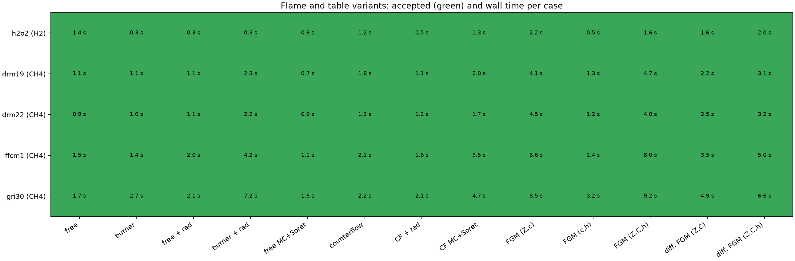

# Estado por mecanismo y variante

Revisión del 12 de octubre de 2026. [Guía de lectura](README.md) · [Mecanismos](mechanisms.md) · [Mecanismos grandes](hpc-large-mechanisms.md) · [Multicomponente en mecanismos grandes](multicomponent-large-mechanisms.md)

Este documento resume qué está cerrado y validado, qué funciona sin validación sistemática con cada mecanismo y qué falta. Sirve para retomar el trabajo sin repetir mediciones.

**Leyenda**

| Marca | Significado |
|---|---|
| ✓ | Validado: prueba automática, comparación con Cantera o con el núcleo exacto, documentado |
| ◐ | Funciona con el mismo código, que no depende del mecanismo, pero no hay una corrida sistemática con ese mecanismo |
| ✗ | No práctico todavía o abierto (ver [Pendiente](#pendiente)) |
| — | No aplica |

## Matriz

Llamas de CH₄/aire salvo H₂-O₂ (H₂/aire). «Mezcla» = transporte promediado por mezcla; «MC» = multicomponente (con o sin Soret).

| Mecanismo | Especies | Premezclada libre, mezcla | Quemador (conducción) | Radiación premezclada / quemador | MC premezclada | Contraflujo, mezcla | Radiación contraflujo | MC contraflujo | FGM premezclado (Z,c) | FGM no adiabático (c,h) y (Z,C,h) | FGM difusión (Z,C) y (Z,C,h) |
|---|---:|---|---|---|---|---|---|---|---|---|---|
| H₂-O₂ | 10 | ✓ | ✓ | ✓ | ✓ | ✓ | ✓ | ✓ | ✓ | ✓ | ✓ |
| DRM19 | 21 | ✓ | ✓ | ✓ | ✓ | ✓ | ✓ | ✓ | ✓ | ✓ | ✓ |
| DRM22 | 24 | ✓ | ✓ | ✓ | ✓ | ✓ | ✓ | ✓ | ✓ | ✓ | ✓ |
| FFCM-1 | 38 | ✓ | ✓ | ✓ | ✓ | ✓ | ✓ | ✓ | ✓ | ✓ | ✓ |
| GRI-Mech 3.0 | 53 | ✓ | ✓ | ✓ | ✓ | ✓ | ✓ | ✓ | ✓ | ✓ | ✓ |
| USC Mech II | 111 | ✓ | ◐ | ◐ | ◐ | ✓ | ◐ | ◐ | ◐ | ◐ | ◐ |
| JetSurF 2.0 | 348 | ✓ | ◐ | ◐ | ✓ (modelo podado) | ✓ | ◐ | ✗ | ◐ | ◐ | ◐ |
| AramcoMech 2.0 | 493 | ✓ | ◐ | ◐ | ✗ | ✓ | ◐ | ✗ | ◐ | ◐ | ◐ |
| AramcoMech 3.0 | 581 | ✓ | ◐ | ◐ | ✗ | ✓ | ◐ | ✗ | ◐ | ◐ | ◐ |

Dónde está cada ✓:

- **Todas las variantes de H₂-O₂, DRM19, DRM22, FFCM-1 y GRI-Mech 3.0:** [`validate_variants.py`](../examples/validate_variants.py) resuelve las 13 variantes con cada mecanismo y todas se aceptan, con los criterios de malla, residuo y cierre de energía de siempre ([matriz y tiempos](#variantes-hasta-gri-mech-30)). Las variantes son:
  - premezclada libre, quemador, ambas con radiación, y multicomponente con Soret;
  - contraflujo de mezcla, radiante y multicomponente con Soret;
  - los cinco generadores de tablas.
- **Mezcla, libre y contraflujo, los nueve mecanismos:** [`example_mechanisms.py`](../examples/example_mechanisms.py) y [mecanismos grandes](hpc-large-mechanisms.md), con el backend comprobado contra Cantera en los nueve ([mecanismos](mechanisms.md)).
- **Quemador, GRI y H₂:** [pérdidas al quemador](heat-loss.md) y [`validate_burner.py`](../examples/validate_burner.py).
- **Radiación premezclada, GRI:** Su −0,19 % y cierre de energía del quemador 1,2 % ([radiación](heat-loss.md#radiación), `tests/test_premixed_radiation.py`).
- **Radiación en contraflujo, GRI y H₂:** [llamas de difusión](diffusion-flames.md).
- **MC con GRI y H₂:** frente a Cantera ([multicomponente](hpc-multicomponent.md), [difusión](diffusion-flames.md)).
- **MC premezclada con JetSurF:** núcleo exacto frente al modelo podado, Su idéntica a 10 cifras (0,3647264429 m/s), 45,4 s frente a 37,7 s ([multicomponente en mecanismos grandes](multicomponent-large-mechanisms.md)).
- **FGM, GRI y H₂:**
  - [FGM premezclado](api.md) (figuras `fgm-ch4-*`, `fgm-h2-*`);
  - [no adiabático](nonadiabatic-fgm.md) y [quemador reducido](reduced-burner.md), GRI;
  - [difusión](diffusion-flames.md), GRI.
- **Contaminantes (CO, NO, NO₂):** GRI ([contaminantes](pollutants.md)).

## Cerrado

- **Premezcladas:**
  - llama libre y quemador isotermo (pérdida por conducción), adiabáticas o con radiación ópticamente delgada;
  - transporte de mezcla o multicomponente, con o sin Soret, y convección upwind o exponencial;
  - continuación desde otra llama;
  - Jacobiano estructurado, escalera de Δt y nueve mecanismos.
- **Contraflujo:**
  - dos entradas independientes, con mezcla o multicomponente (con o sin Soret) y radiación;
  - refinamiento multipunto;
  - Jacobiano estructurado y Newton–Krylov para mecanismos grandes con mezcla;
  - arranque de mezcla para llamas multicomponentes o con Soret.
- **Tablas:**
  - FGM premezclado (Z,c) adaptativo;
  - FGM de quemador (c,h);
  - FGM no adiabático (Z,C,h) con generación en paralelo;
  - FGM de difusión (Z,C) y radiativo (Z,C,h) con filas en paralelo;
  - validación con flamelets reservados;
  - quemador reducido.
- **Revisiones:** todos los hallazgos de la revisión del 8 de octubre cerrados ([revisión](reviews/repository-hpc-2026-10-08.md)).
- **Multicomponente con mecanismos grandes:**
  - núcleo podado sin colisiones traza–traza, 6–60× más rápido por cara en Aramco 3.0, con la precisión medida en [su documento](multicomponent-large-mechanisms.md);
  - opción pública `multicomponent_trace`;
  - GMRES con precondicionador de mezcla, automático en premezclada desde 400 especies y en contraflujo con el modelo podado.

## Variantes hasta GRI-Mech 3.0

[Datos](assets/variants/variants-2026-10-12.json). Ryzen 9 7845HX, prioridad alta, caché Numba caliente, valores por defecto (`convection='auto'`). Tiempo de pared por caso, con la API incluida; los 65 casos se aceptan.

| Mecanismo | Libre | Quemador | + rad. | Quemador + rad. | MC + Soret | Contraflujo | CF + rad. | CF MC + Soret | FGM (Z,c) | FGM (c,h) | FGM (Z,C,h) | FGM dif. (Z,C) | FGM dif. (Z,C,h) |
|---|---:|---:|---:|---:|---:|---:|---:|---:|---:|---:|---:|---:|---:|
| H₂-O₂ | 1,4 | 0,3 | 0,3 | 0,3 | 0,6 | 1,2 | 0,5 | 1,3 | 2,2 | 0,5 | 1,6 | 1,6 | 2,0 |
| DRM19 | 1,1 | 1,1 | 1,1 | 2,3 | 0,7 | 1,8 | 1,1 | 2,0 | 4,1 | 1,3 | 4,7 | 2,2 | 3,1 |
| DRM22 | 0,9 | 1,0 | 1,1 | 2,2 | 0,9 | 1,3 | 1,2 | 1,7 | 4,5 | 1,2 | 4,0 | 2,5 | 3,2 |
| FFCM-1 | 1,5 | 1,4 | 2,0 | 4,2 | 1,1 | 2,1 | 1,6 | 3,5 | 6,6 | 2,4 | 8,0 | 3,5 | 5,0 |
| GRI-Mech 3.0 | 1,7 | 2,7 | 2,1 | 7,2 | 1,6 | 2,2 | 2,1 | 4,7 | 8,5 | 3,2 | 9,2 | 4,9 | 6,6 |

Tiempos en segundos. En la primera matriz de ese día, con la caché fría y sin estas mejoras, la familia no adiabática de GRI tardaba 28,1 s y el FGM de quemador de FFCM-1 25,3 s; además fallaban las premezcladas de H₂ y sus familias de quemador.

Optimizaciones del 12 de octubre. Cada una se aplica a todos los mecanismos solo después de comprobar, caso por caso en la matriz, que acelera sin empeorar ningún otro:

| Cambio | Efecto medido |
|---|---|
| `generate_burner_fgm` encadena las llamas: la primera parte de la llama libre adiabática y cada siguiente de la anterior, como ya hacía `generate_nonadiabatic_fgm` | FFCM-1, 25,3 → 2,7 s; GRI, 8,9 → 3,2 s |
| Continuación que cambia el flujo másico: la semilla se reduce a 80 de sus nodos (con su agrupamiento) antes del pseudo-transitorio y se refina con los criterios de siempre, como en contraflujo | Familia no adiabática de GRI, 21,2 → 10,1 s (una llama rica con pérdida fuerte, 15,3 → 2,2 s); FFCM-1, 15,9 → 8,8 s; DRM19, 10,0 → 4,0 s |
| Hasta 12 pasadas de refinamiento (antes 6). Cada pasada solo ocurre si la malla cambia, así que una malla que convergía antes no cambia | Las continuaciones desde una malla gruesa ya no se rechazan por agotar las pasadas |
| Si una llama de quemador de una familia supera la tolerancia de cierre de energía, se resuelve otra vez desde su propio estado con slope y curve a la mitad (como mucho dos veces); las que cumplen no cambian | H₂ pobre (φ = 0,6, pérdida débil): cierre 2,4 % → 1,2 %; la familia no adiabática de H₂ se acepta |
| Especies de salida por defecto: solo las presentes en el mecanismo | H₂-O₂ (sin carbono) ya no falla con los valores por defecto |

### Esquema convectivo exponencial por defecto (premezcladas)

Estudio de malla (slope/curve de 0,04/0,08 a 0,005/0,01). Su en m/s; el valor de referencia es el convergido:

| Caso | Upwind, malla por defecto | Exponencial, malla por defecto | Convergido |
|---|---:|---:|---:|
| H₂/aire, φ = 0,6 | 0,7824 (−4,6 %) | 0,8190 (−0,1 %) | 0,820 |
| H₂/aire, φ = 1,0 | 2,3362 (+0,2 %) | 2,3309 (0,0 %) | 2,331 |
| CH₄/aire GRI, φ = 0,7 | 0,1941 (+1,1 %) | 0,1920 (0,0 %) | 0,1919 |
| CH₄/aire GRI, φ = 1,0 | 0,3788 (+1,5 %) | 0,3733 (0,0 %) | 0,3731 |
| CH₄/aire GRI, φ = 1,3 | 0,2367 (+1,3 %) | 0,2332 (−0,2 %) | 0,2337 |

Upwind es de primer orden: incluso con la malla más fina sigue a −0,9 % en H₂, φ = 0,6. El contraflujo ya está convergido en su malla por defecto (refinar 4× cambia Tmax 0,3 K en CH₄ y 1 K en H₂, y el calor liberado 0,007 % y 0,2 %), así que conserva upwind.

Para que el exponencial fuera robusto y rápido como valor por defecto hizo falta:

1. **Derivada de los pesos de Péclet en los Jacobianos analíticos.** Ambos ensambladores, el denso y el estructurado, dejaban congelados los pesos. Con ello las columnas de u tenían un 16 % de error y ahora coinciden con diferencias finitas a 3·10⁻⁹.
2. **Arranque multicomponente desde la llama de mezcla del mismo esquema.** Antes se saltaba de una multicomponente upwind a la exponencial con el transporte caro.
3. **Continuaciones que cambian el caudal pasan primero por upwind** y se corrigen con el esquema pedido. Quemador rico de GRI con pérdida fuerte: 10,6 s → 1,1 s, misma llama a 0,007 K.
4. **Envolvente creciente del progreso en los tabuladores de quemador.** Los descensos de ruido de 3·10⁻¹⁰ cerca de c = 0 ya no rompen la parametrización (familias de H₂).
5. **`convection='auto'`:** exponencial, salvo con Soret (upwind).

Resultado: las 13 variantes × 5 mecanismos se aceptan. El coste en llamas sueltas es casi igual (GRI 1,8 s frente a 1,6 s), y el cierre de energía del quemador mejora (0,09 % frente a 0,48 % en la llama más difícil de la familia de GRI).

Medido y descartado:

- **Escalera de Δt por debajo de 100 especies.** No mejora GRI y, con quemador y radiación, pasa de 8,2 s a 34,6 s (ratio 4) o 13 s (ratio 2).
- **Quemador radiante continuado desde el no radiante.** Es 2× más rápido, pero el cierre empeora (2,5 % frente a 1,7 %) y Tmax se mueve 1 K.
- **`jobs=3` en el FGM premezclado adaptativo.** No acelera (9,4 → 10,2 s) y la tabla difiere.

En la familia no adiabática, `jobs=3` reduce de 28,4 a 19,4 s con tabla idéntica. Sigue siendo opcional.

## Pendiente

Por orden de prioridad. Cada punto indica qué se midió y cómo continuar.

1. **Validación sistemática de variantes con USC, JetSurF y Aramco** (las casillas ◐). Hasta GRI está cerrada con [`validate_variants.py`](../examples/validate_variants.py); para los mecanismos grandes hay que añadir sus casos a ese ejemplo, de uno en uno.
2. **MC en contraflujo con JetSurF y Aramco (✗).**
   - Con el modelo podado, el arranque de mezcla y GMRES precondicionado por el Jacobiano estructurado de mezcla, JetSurF llega a la corrección multicomponente en unos 45 s (llama de mezcla, 1510 nodos).
   - En esa malla fina GMRES no converge en 12 iteraciones (5 de 5 llamadas). Cada iteración es un residual multicomponente de unos 0,8 s, así que la llama tarda más de 10 min.
   - En 61–121 nodos converge en 2 iteraciones (GRI y JetSurF) y los productos sin matriz son lineales: no hay ruido por el cambio de especies mayoritarias.
   - Siguiente paso: [`audit_multicomponent_krylov.py`](../examples/audit_multicomponent_krylov.py) `jetsurf2.yaml --refine` para ver el estado de la malla fina. Opciones a medir:
     - más iteraciones con reinicio;
     - productos Jv con el transporte congelado, como el Jacobiano de Cantera, de coste O(n²) por cara;
     - un precondicionador con los coeficientes efectivos multicomponentes.
   - Ya aplicado: las caras multicomponentes usan los hilos de cálculo pesado.
3. **MC premezclada con AramcoMech (✗).**
   - El camino existe y está probado en GRI: núcleo podado, factorización estructurada de mezcla como precondicionador de GMRES anclado en cada iterado y arranque de mezcla.
   - Falta la llama completa. El Jacobiano MC denso de Aramco (~6 GB) no cabe junto al resto, por eso este camino es automático desde 400 especies.
   - En GRI (forzado), Su difiere 8·10⁻⁶ del núcleo exacto: es la tolerancia de Newton, no el modelo.
4. **Pivotes dispersos + rango bajo** (coste cúbico de la factorización, ~60 % del tiempo de Aramco).
   - Medido con [`audit_chemistry_sparsity.py`](../examples/audit_chemistry_sparsity.py):

     | Mecanismo | Parte estequiométrica | Relleno de LU (grado mínimo) | LU dispersa (SuperLU) | Inversa densa | Colisionadores |
     |---|---:|---:|---:|---:|---:|
     | Aramco 3.0 | 3,8 % | 6,6 % | 3,4 ms | 17,4 ms | 14 |
     | JetSurF | 6,5 % | 10,3 % | 1,7 ms | 4,9 ms | 10 |
     | GRI | 40 % | 48 % | — | — | — (la densa gana) |

   - En la eliminación exacta el pivote es denso (contiene la inversa del pivote anterior). La estructura solo puede aprovecharse en una factorización aproximada, usada como precondicionador de GMRES, y el beneficio depende de cuántas iteraciones añada.
   - Siguiente paso: medir con una factorización aproximada que conserve exactamente los términos de rango bajo y aproxime la parte densa del término de Schur por su diagonal o por el patrón químico; adoptarla solo si acelera con la misma llama.
5. **Pseudo-transitorio en la malla inicial.** En el arranque de mezcla de JetSurF en contraflujo, la malla de 31 nodos hace unas 125 factorizaciones (13 de 42 s): casi un Jacobiano nuevo por paso de tiempo. Por debajo de 400 especies Newton es directo, porque Krylov empataba en la llama completa. Se puede revisar con la escalera de Δt de la premezclada.
6. **Soret con el esquema exponencial.** La deriva térmica −D_T∇T/T se discretiza centrada, con la Y media de la cara. Con exponencial, el CO₂ baja hasta la cota (−10⁻⁷) delante de la llama de GRI y la llama tarda ~40 s. Por eso `'auto'` usa upwind con Soret. La solución es discretizar la deriva con la celda donante, que conserva la positividad; afecta al residual y a los cuatro Jacobianos.
7. **`generate_fgm(jobs>1)` da una tabla distinta de `jobs=1`** (mismos 15 flamelets, términos fuente distintos hasta ~1 %). La causa es que en paralelo cada puente parte de una instantánea de sus vecinos tomada al inicio de la ronda, mientras que en serie también ve los puentes ya resueltos en esa ronda. Las dos tablas cumplen la tolerancia, pero no son la misma; por defecto se mantiene `jobs=1`.
8. **Quemador radiante.** El dominio se amplía de 0,03 a 0,06 m por un juicio hecho en la malla inicial de 8 nodos, donde el calor liberado a la salida se sobrestima. Coste: GRI 8–10 s frente a 3 s sin radiación. Partir de 0,06 m no ayuda: se amplía a 0,12 m y tarda lo mismo, y Tmax solo cambia 0,1 K. Hay que revisar el criterio de salida radiante con validación propia.
9. ~~H₂ pobre con upwind~~ (cerrado: el esquema por defecto es exponencial; ver arriba).
10. **Comparación de tiempos de GRI multicomponente con la versión anterior.** El caso publicado (contraflujo CH₄, MC + Soret), con núcleos calentados, tarda ahora 4,8 s; la documentación registraba 10,6 s y 17,4 s en campañas anteriores. Falta repetir el commit anterior en esta misma máquina para atribuir la diferencia: probablemente es el arranque de mezcla.

## Datos medidos el 11 y 12 de octubre

| Medida | Valor |
|---|---|
| Núcleo MC por cara, un hilo | JetSurF 13–21 → 0,2–1,7 ms; Aramco 3.0 51–66 → 0,8–10,4 ms |
| Modelo podado frente al exacto (flujos, ponderado por masa) | GRI 8·10⁻¹⁰, USC 1,9·10⁻⁹, JetSurF 2,4·10⁻⁹, Aramco 3.0 2,6·10⁻⁹; D_T y λ 10⁻¹⁴ |
| JetSurF premezclada MC (CH₄, φ = 1) | Su idéntica a 10 cifras; 45,4 s (exacto) y 37,7 s (podado) |
| GRI contraflujo MC (podado forzado frente a exacto) | ΔT máx 5,7·10⁻⁷ K |
| JetSurF contraflujo MC | mezcla en 45 s; la corrección MC no termina en 10 min (punto 2) |
