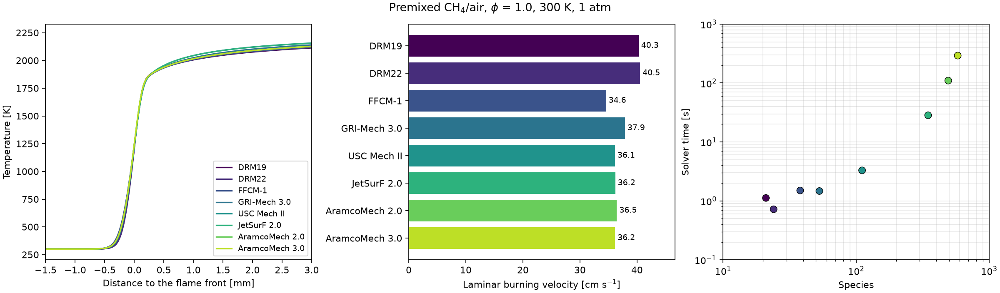
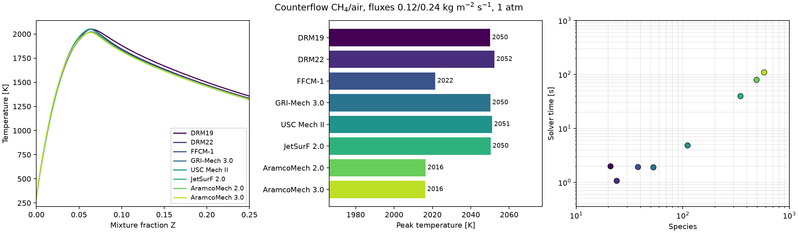

# Mecanismos químicos disponibles

[Guía de lectura](README.md) · [API](api.md)

Los siguientes archivos se incorporaron desde fuentes oficiales y se
convirtieron sin quitar reacciones. Los recuentos incluyen las especies
inertes de la fase. La ampliación añade soporte nativo de PLOG y SRI en
cinética, evaluación fusionada, reutilización térmica y derivadas analíticas;
Cantera se utiliza para conversión y comprobación, no durante la resolución
nativa.

El Jacobiano analítico admite también molecularidad entera superior a tres,
necesaria para USC/JetSurF. Usa planes propios de diferenciación; la evaluación
de tasas conserva sus planes anteriores y su recorrido logarítmico para esos
órdenes. No se cambian los coeficientes ni se eliminan reacciones.

| Mecanismo | Especies | Reacciones | Nombre de entrada | Instalación |
|---|---:|---:|---|---|
| H₂/O₂ | 10 | 29 | `h2o2.yaml` | Incluido |
| DRM19 | 21 | 84 | `drm19.yaml` | Incluido |
| DRM22 | 24 | 104 | `drm22.yaml` | Incluido |
| FFCM-1 | 38 | 291 | `ffcm1.yaml` | Incluido |
| GRI-Mech 3.0 | 53 | 325 | `gri30.yaml` | Incluido |
| USC Mech II | 111 | 784 | `uscmech2.yaml` | Incluido |
| JetSurF 2.0 | 348 | 2163 | `jetsurf2.yaml` | Incluido |
| AramcoMech 2.0 | 493 | 2716 | `aramcomech2.yaml` | Local del usuario |
| AramcoMech 3.0 | 581 | 3037 | `aramcomech3.yaml` | Local del usuario |

**21 especies y 84 reacciones identifican DRM19, no DRM22.** DRM22 tiene
22 especies reactivas más N₂ y Ar. Los archivos oficiales de ambos modelos
se conservaron con nombres separados.

## Selección

```sh
python -m kflame mechanisms
flampy mechanisms
flampy mechanisms --json
flampy diffusion --mechanism ffcm1.yaml --fuel CH4 --output runs/ffcm1
```

En Python se puede usar el nombre de archivo o el alias del catálogo:

```python
from kflame import solve_diffusion_flame

flame = solve_diffusion_flame(
    mechanism="USC Mech II", fuel="CH4:1,N2:4", output="runs/usc_ch4_diluted"
)
```

En los archivos USC, JetSurF y Aramco el intervalo común de los polinomios
NASA es 300–2000 K, pero la llama estequiométrica de CH₄/aire supera 2200 K.
La búsqueda del equilibrio adiabático que inicializa las llamas amplía su
intervalo hasta 2·T_max cuando hace falta, la misma cota que ya usa el
resolvedor. Por eso CH₄/aire puro arranca con todos los mecanismos del catálogo.
Los coeficientes y el intervalo original se conservan. El ejemplo de USC con
combustible diluido de arriba es solo otro caso físico; no es necesario para
que el cálculo arranque.

AramcoMech se instaló en `~/.kflame/mechanisms` en esta máquina; esos YAML
no se incluyen en el paquete. En otra máquina hay que proporcionar los
archivos locales del mecanismo, termoquímica y transporte convertidos, o
una ruta explícita al YAML. El directorio se puede configurar en PowerShell:

```powershell
$env:KFLAME_MECHANISM_DIR = 'C:\mis-mecanismos'
flampy mechanisms
flampy diffusion --mechanism aramcomech2.yaml --fuel 'CH4:1,N2:4' --output runs/aramco2_diluted
```

Un mecanismo local ausente produce un error; no se sustituye por GRI ni por
otra versión. Cambiar el mecanismo cambia la química del cálculo: no es una
optimización HPC que mantenga la misma solución.

## Mismo caso con todos los mecanismos

[`examples/example_mechanisms.py`](../examples/example_mechanisms.py) resuelve la
misma llama con cada mecanismo instalado: premezclada de CH₄/aire (φ = 1,
300 K, 1 atm) o, con `--flame diffusion`, contraflujo de CH₄/aire. Guarda cada
llama en su carpeta y un `summary.json` con perfiles, velocidad de llama o
temperatura máxima, nodos y tiempo del solver. La figura se dibuja solo desde
ese archivo.

```sh
python examples/example_mechanisms.py
python examples/example_mechanisms.py --flame diffusion
python examples/example_mechanisms.py --plot-only docs/assets/mechanisms/premixed-ch4.json
```





| Mecanismo | Especies | Premezclada: Su (cm/s) | Premezclada: tiempo (s) | Contraflujo: Tmax (K) | Contraflujo: tiempo (s) |
|---|---:|---:|---:|---:|---:|
| DRM19 | 21 | 40,3 | 1,1 | 2050 | 2,0 |
| DRM22 | 24 | 40,5 | 0,7 | 2052 | 1,1 |
| FFCM-1 | 38 | 34,6 | 1,5 | 2022 | 1,9 |
| GRI-Mech 3.0 | 53 | 37,9 | 1,5 | 2050 | 1,9 |
| USC Mech II | 111 | 36,1 | 3,3 | 2051 | 4,8 |
| JetSurF 2.0 | 348 | 36,2 | 28,4 | 2050 | 39,5 |
| AramcoMech 2.0 | 493 | 36,5 | 109,9 | 2016 | 79,2 |
| AramcoMech 3.0 | 581 | 36,2 | 292,3 | 2016 | 109,0 |

Ryzen 9 7845HX, prioridad alta, un proceso por figura. FFCM-1 premezclada midió
6,7 s en esa ejecución porque fue la primera llama con tasas dependientes de la
presión y pagó la compilación JIT; en dos procesos nuevos tarda 1,5 s, con la
misma Su y la misma malla (se publica 1,5 s y se conserva la nota en el JSON).

Los datos publicados están en [premixed-ch4.json](assets/mechanisms/premixed-ch4.json)
y [diffusion-ch4.json](assets/mechanisms/diffusion-ch4.json). Cambiar el
mecanismo cambia la química y, por tanto, la solución: las diferencias entre
curvas son del mecanismo, no del solver. Cómo se consiguen estos tiempos con
los mecanismos grandes: [Jacobiano estructurado, Newton–Krylov y transporte
vectorizado](hpc-large-mechanisms.md).

## Procedencia y convenciones de conversión

DRM procede de [Berkeley](http://combustion.berkeley.edu/drm/); su
termoquímica y transporte se completan con los archivos GRI 1.2 enlazados
por los autores. FFCM-1 procede de la
[distribución Stanford–SRI](https://web.stanford.edu/group/haiwanglab/FFCM1/pages/download.html),
usando su versión Cantera sin la actualización especial de transporte.
USC procede del [directorio oficial de Hai Wang Lab](https://web.stanford.edu/group/haiwanglab/USC%20Mech%20II/Mechanisms/USC%20Mech%20II/);
JetSurF procede de su
[distribución 2.0](https://web.stanford.edu/group/haiwanglab/JetSurF/JetSurF2.0/index.html).
Aramco procede del
[Combustion Chemistry Centre de Galway](https://www.universityofgalway.ie/combustionchemistrycentre/mechanismdownloads/).

La conversión usa `ck2yaml`/`cti2yaml` de Cantera 3.2.0. Las fuentes de
USC/JetSurF contienen alternativas duplicadas de termoquímica y transporte:
se usa la primera entrada, siguiendo la convención del convertidor, y las
alternativas completas se conservan como datos suplementarios. Los doce
ajustes binarios especiales adjuntos se preservan pero no se utilizan en el
cierre estándar Lennard-Jones/Cantera de esta integración. No se afirma
equivalencia con un ejecutable CHEMKIN que active esos ajustes especiales.

Aramco 2.0 tiene declaraciones redundantes auditadas como idénticas.
Aramco 3.0 incluye alternativas distintas para once especies en termoquímica
y cuatro en transporte. La conversión local usa explícitamente la primera
entrada de cada especie; todos los registros originales se conservan en
`3.0/duplicate-audit.json`. No se presenta esa elección como una corrección
de los autores ni se afirma que las alternativas sean equivalentes. Se
conservan los avisos de continuidad NASA emitidos por Cantera.

Los archivos de Aramco y sus fuentes quedan como instalación local, con
avisos y atribuciones intactos. El enlace a los
[términos de la institución](https://www.universityofgalway.ie/footer-links/copyright.html)
se conserva en la procedencia; esta instalación no publica ni redistribuye
los archivos de Aramco.

## Comprobaciones

`tests/test_mechanism_catalog.py` comprueba nombres, orden de especies,
recuentos íntegros, pesos moleculares, NASA-7, tasas nativas y conservación
elemental contra Cantera a 500/1100/2300 K y 0,1/1/10 atm. Los mecanismos
externos se prueban cuando están instalados. `tests/test_pressure_rates.py`
ejercita PLOG, SRI y Troe con escalas negativas en rutas NumPy/densa/sparse, paquetes fusionados y
agrupados, derivadas térmicas y de composición, y casos límite de presión.
El checkpoint de ampliación de mecanismos, anterior a los nuevos cambios HPC,
dio **788 pruebas aprobadas** y 33 avisos, conservando
los avisos NASA/Troe de Cantera. Las 221 pruebas afectadas están incluidas
en ese total y no deben sumarse. Los nueve mecanismos instalados pasan la
comprobación del backend contra Cantera.

[Evidencia de los mecanismos instalados](assets/chemistry/mechanisms-2026-10-09.json)
incluye recuentos, hashes, entorno, avisos de los originales y el alcance de
cada comprobación. La ruta compilada de diferencias finitas de difusión
transmite también PLOG/SRI; su prueba contrasta el Jacobiano local con
perturbaciones independientes del residual público.

Para los mecanismos anteriores se comprobaron seis configuraciones de H₂/CH₄:
mezcla, multicomponente con Soret y radiación. El calentamiento adaptativo y
una resolución nueva por configuración dieron **12 comparaciones exactas de
los 21 campos exportados** contra la fuente preservada. El manifiesto de
69 archivos Python/YAML permaneció sin cambios durante esa comprobación.
Esta prueba verifica resultados; no constituye una nueva medición emparejada
de aceleración HPC.

La campaña HPC posterior valida el mismo árbol integrado con **853 pruebas
aprobadas**, comparación de transporte/cinética contra Cantera en los nueve
mecanismos y doce pares exactos de llamas completas. Sus tiempos emparejados,
intervalos y decisión CPU/GPU están en [HPC por mecanismo](hpc-mechanisms.md).

Con el Jacobiano estructurado, la factorización por tramos y la llama premezclada
estructurada integrados, la suite completa da **1077 pruebas aprobadas y ningún
fallo** (11 de octubre de 2026).

Para repetir la comprobación del backend completo con los mecanismos instalados:

```sh
python examples/validate_mechanisms.py --output runs/mechanism-check.json
```

Ese ejemplo contrasta transporte promediado por mezcla, cinética fusionada y
termoquímica con Cantera, y comprueba igualdad byte a byte entre los recorridos
analíticos completo y por bloques. Requiere el extra `reference`.

Los originales, hashes, advertencias y resultados de conversión se guardan
localmente en `.local/mechanisms-2026-10-09/`. La admisión de un YAML y las
comprobaciones de tasas no equivalen a validar una llama completa ni a medir
el rendimiento de los mecanismos grandes.
