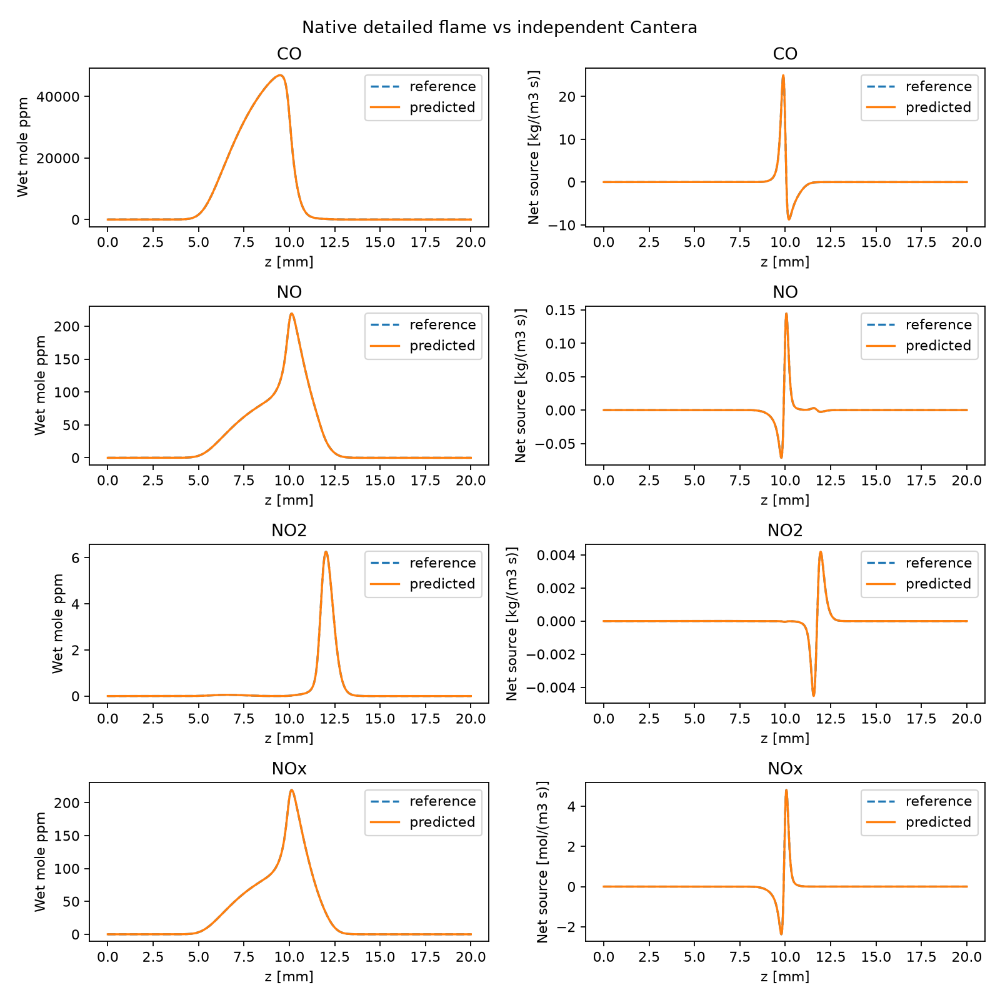
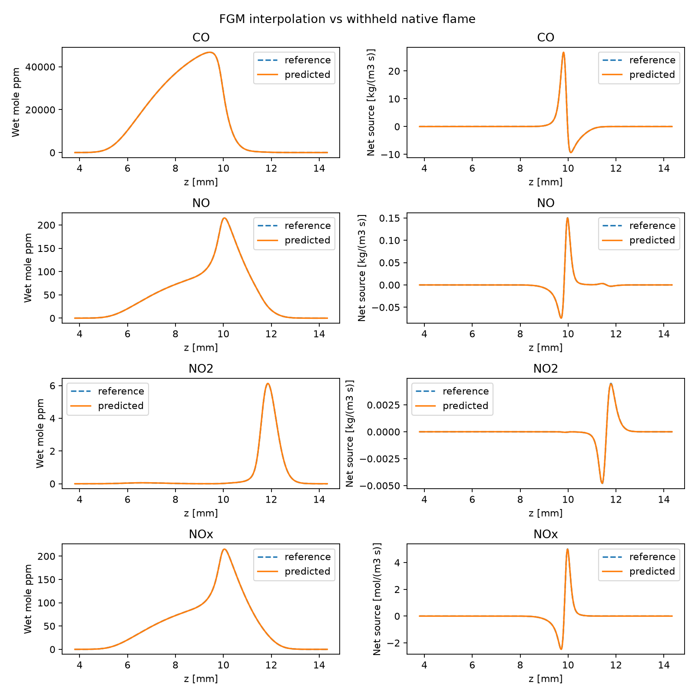

# Concentraciones y fuentes de contaminantes

El primer estudio usa metano/aire y GRI-Mech 3.0 en contraflujo: entradas a
300 K, 101325 Pa, separación de 0.02 m, caudales de 0.12 y 0.24 kg/(m² s),
transporte promediado, sin Soret y sin radiación. No se añaden pérdidas de
calor arbitrarias a esta prueba.

```powershell
$env:PYTHONPATH='src'
python examples/validate_diffusion_pollutants.py --output runs/gri30_pollutants --fgm
```

El script resuelve una llama nativa desde una estimación propia y una referencia
independiente de Cantera. Con `--fgm`, entrena la tabla nativa en escalas de
caudal 0.75, 1 y 1.25; reserva 1.1 para validar la interpolación. La familia y
la llama reservada usan continuación nativa explícita. Cantera nunca proporciona
una estimación inicial al solver nativo. Los tiempos de continuación no son
comparables con los de un arranque independiente.

`kflame.pollutants` admite una selección genérica de especies presentes en el
mecanismo. La selección de este ejemplo es CO, NO y NO₂. Si se seleccionan NO
y NO₂, añade NOx = NO + NO₂. No interpreta especies ausentes como emisiones
nulas.

## Unidades y criterios

Se calculan concentraciones locales en ppm molares húmedas:

\[
X_k=\frac{Y_k/W_k}{\sum_j Y_j/W_j},\qquad \mathrm{ppm}_k=10^6 X_k.
\]

Se conservan los valores negativos numéricos; no se recortan. No se aplica
corrección a oxígeno de referencia ni conversión a gas seco. Las fuentes netas
individuales se expresan en kg/(m³ s). La fuente de NOx se suma en base molar,
en mol/(m³ s), utilizando pesos moleculares en kg/kmol:

\[
\dot\omega_{\mathrm{NOx}}
=1000\left(\frac{\dot\omega_{\mathrm{NO}}}{W_{\mathrm{NO}}}
+\frac{\dot\omega_{\mathrm{NO_2}}}{W_{\mathrm{NO_2}}}\right).
\]

La referencia de Cantera se convierte a ppm antes de interpolar a la malla
nativa. Se comparan perfiles en la misma posición física, sin desplazamientos
ni extrapolación. La tolerancia de exploración por contaminante es:

- Concentración: error máximo ≤ 1 ppm + 5% del máximo absoluto de referencia.
- Fuente: error máximo ≤ 1e-8 + 10% del máximo absoluto de referencia, en las
  unidades declaradas para cada fila.

Estos límites son configurables y no representan certificación de emisiones.
El informe incluye el error relativo al pico propio, el pico de ambos perfiles
y los límites empleados. No se usa el máximo de las especies mayoritarias para
normalizar los errores de NO o NO₂.

En FGM, las fuentes se interpolan desde la tabla y no se recalculan mediante
química detallada. Los errores se miden solamente en puntos cubiertos; la
cobertura debe superar el 99% de los puntos cuya concentración o fuente supera
el 1% del máximo absoluto de cada contaminante de la llama completa. Es una
comprobación adicional a la cobertura basada en liberación de calor. Los picos
del informe FGM corresponden al subconjunto cubierto.

La salida conserva `summary.json`, las llamas y referencias completas, informes
por contaminante, perfiles CSV/NPZ y gráficas PNG/PDF. Un fallo en la validación
se comunica mediante un código de salida distinto de cero y conserva sus datos.

## Alcance

La comparación con Cantera comprueba consistencia numérica con el mismo
mecanismo; no sustituye la validación experimental. Las ppm locales y las
fuentes químicas no son un factor de emisión ni un caudal de contaminantes
a la salida de un quemador. La geometría de contraflujo incluye exportación
radial y requiere un volumen de control apropiado para calcular emisiones.

Esta extensión audita el solver detallado y la tabla `(Z,C)` existentes. No
implementa todavía una ecuación de transporte independiente para NOx, hollín
ni un control independiente de entalpía. Si falla la interpolación de NOx en
nuevas condiciones, debe estudiarse si hacen falta controles o transporte
adicionales antes de ampliar la tabla.

## Prueba ejecutada el 7 de octubre de 2026

Pasan los criterios de exploración y la comparación general de la llama en
las dos referencias independientes de Cantera y en la prueba reservada FGM.
Estos resultados corresponden a las condiciones descritas arriba.

| Contaminante | Pico local nativo, ppm | Error máximo nativo/Cantera, ppm | Error de fuente / escala propia |
|---|---:|---:|---:|
| CO | 46892.46 | 56.763 | 0.730% |
| NO | 219.31 | 0.261 | 0.856% |
| NO₂ | 6.26 | 0.011 | 0.496% |
| NOx = NO + NO₂ | 219.33 | 0.261 | 0.857% |

Los picos de NO y NO₂ aparecen en posiciones distintas; el pico de su suma
se calcula sobre el perfil completo, no sumando sus máximos individuales.

La familia FGM entrena tres llamas y se valida en escala de caudal 1.1:

| Contaminante | Error máximo FGM/reservada, ppm | Error de fuente / escala propia | Cobertura significativa de concentración y fuente |
|---|---:|---:|---:|
| CO | 6.645 | 0.422% | 100% |
| NO | 0.210 | 0.307% | 100% |
| NO₂ | 0.026 | 1.071% | 100% |
| NOx = NO + NO₂ | 0.210 | 0.308% | 100% |

La tabla cubre 1283 de los 1405 puntos espaciales de la llama reservada.
Los 122 puntos excluidos no entran en los errores. La cobertura del 100%
se refiere a los puntos que superan el umbral significativo definido arriba,
no a todos los puntos del dominio.

En la campaña guardada de contaminantes, el arranque independiente tarda
**47.53 s nativos / 34.85 s Cantera**: Cantera es más rápido en esa muestra.
El hash de esa campaña difiere del registrado en los informes HPC de difusión;
sus tiempos no describen el rendimiento del código local actual.
Las tres llamas de
entrenamiento usan continuación nativa y tardan 23.12, 28.17 y 20.49 s.
La llama reservada tarda 13.00 s con continuación nativa y 36.82 s en Cantera
desde una estimación independiente. Esta última pareja no demuestra ventaja
del solver nativo desde arranques equivalentes. Son muestras locales únicas,
sin una conclusión estadística de rendimiento ni un tiempo de consulta FGM.

[Evidencia numérica, condiciones, tolerancias y hashes](assets/pollutants/gri30-validation.json).
Las salidas completas se conservan localmente en `runs/gri30_pollutants`.





Referencias: [GRI-Mech 3.0 distribuido por Cantera](https://cantera.org/3.2/examples/input/gri30.html)
y [Ortolani et al. (2024), comparación de cierres de NOx en FGM](https://eprints.gla.ac.uk/328310/).
